# Citizen Assist AI — Segurança do Cidadão

Protótipo em **Python** desenvolvido para a **Global Solution 2026.2 (FIAP)**, na disciplina de **Data Structures and Algorithms (DSA)**.

O sistema organiza e permite consultar serviços e orientações de **segurança pública e proteção ao cidadão**, como números de emergência, canais de denúncia, Defesa Civil, boletim de ocorrência online e dicas de segurança digital. Tudo roda no terminal, sem dependências externas.

## Autores

| Nome | RM |
|---|---|
| Carlos Eduardo Affonso | 569676 |
| Igor Massone Monteiro | 573853 |

## Funcionalidades

- **Cadastro** de serviços com ID único e campos validados (título, categoria, descrição, requisitos e local de atendimento)
- **Consulta** por ID
- **Pesquisa** por título ou categoria, ignorando maiúsculas e acentos
- **Atualização** de registros (Enter mantém o valor atual)
- **Exclusão** com confirmação
- **Ordenação** por ID, título ou categoria
- **Análise** com o total de registros e a quantidade e o percentual por categoria
- **Persistência** opcional em JSON, salva ao encerrar o programa
- **Validações** para entradas inválidas, opções inexistentes, IDs duplicados, consultas sem resultado e lista vazia

## Estruturas de dados e algoritmos

- **Lista encadeada própria** (`No` e `ListaEncadeada`) com ponteiros para cabeça e cauda. Os registros ficam apenas nos nós, sem `list` ou `dict`.
- **Busca linear** por ID e por atributo de texto.
- **Merge Sort** implementado na própria lista encadeada. É estável e não usa funções prontas de ordenação.

| Operação | Complexidade |
|---|---|
| Inserção no fim | O(n), pela checagem de ID duplicado |
| Busca por ID | O(n) |
| Pesquisa por texto | O(n·m) |
| Atualização | O(n) |
| Remoção | O(n) |
| Ordenação (Merge Sort) | O(n log n) |

A justificativa de cada item está em [`DOCUMENTACAO.md`](DOCUMENTACAO.md).

## Como executar

Requisito: **Python 3.8 ou superior**.

```bash
# Clonar o repositório
git clone <URL-DO-REPOSITORIO>
cd <NOME-DA-PASTA>

# Executar o sistema
python citizen_assist.py        # no Windows também funciona: py citizen_assist.py

# Executar os testes automatizados
python test_citizen_assist.py
```

Ao abrir, o sistema carrega 8 registros iniciais, caso não exista um `dados_servicos.json`. Para voltar aos dados iniciais, apague esse arquivo.

## Menu

```
1 - Cadastrar        5 - Pesquisar
2 - Consultar por ID 6 - Ordenar e exibir
3 - Atualizar        7 - Análise
4 - Excluir          8 - Listar (ordem atual)
0 - Encerrar
```

## Testes

O arquivo `test_citizen_assist.py` traz 22 testes com `unittest`, cobrindo:

- operações com lista vazia
- inserção, busca e remoção (cabeça, meio e fim)
- IDs duplicados e entradas inválidas
- pesquisa com e sem resultado
- ordenação, estabilidade e lista grande
- fluxo do menu e persistência, incluindo JSON corrompido

## Evidências de testes

Capturas de tela da execução real do sistema (pasta [`evidencias`](evidencias)).

### 1. Testes automatizados
Execução dos 22 testes com `unittest`.

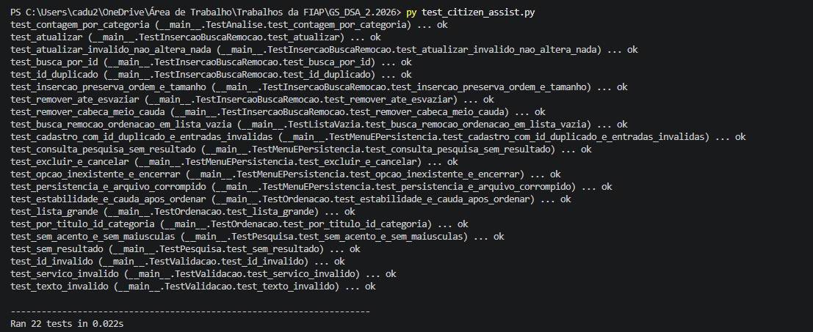

### 2. Exclusão cancelada
O usuário responde `n` e o registro é mantido.

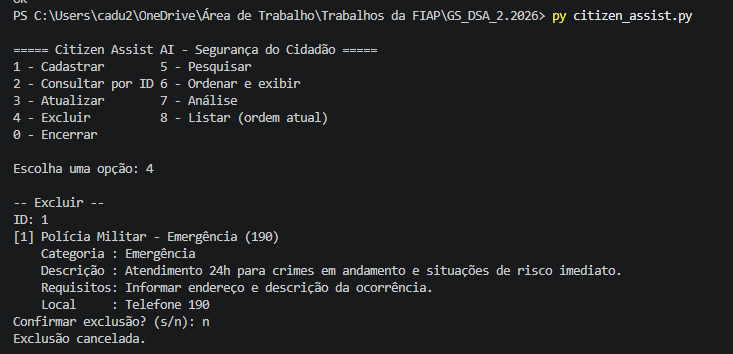

### 3. Exclusão confirmada
O usuário responde `s` e o registro é removido.

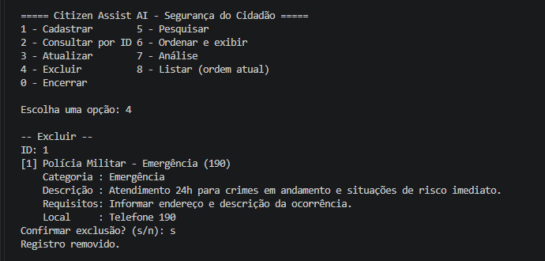

### 4. Consulta de ID inexistente
Consulta pelo ID removido retorna mensagem de não encontrado.

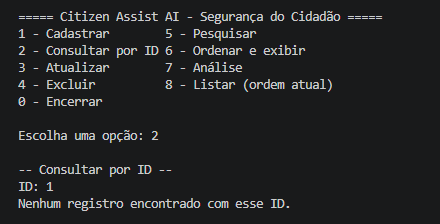

### 5. Validação de ID inválido
Entradas `-5` e `abc` são recusadas e o ID é pedido de novo.

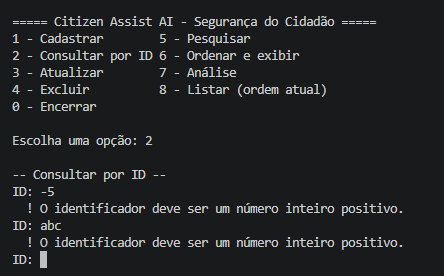

### 6. Listagem após a exclusão
O registro removido não aparece mais na lista.

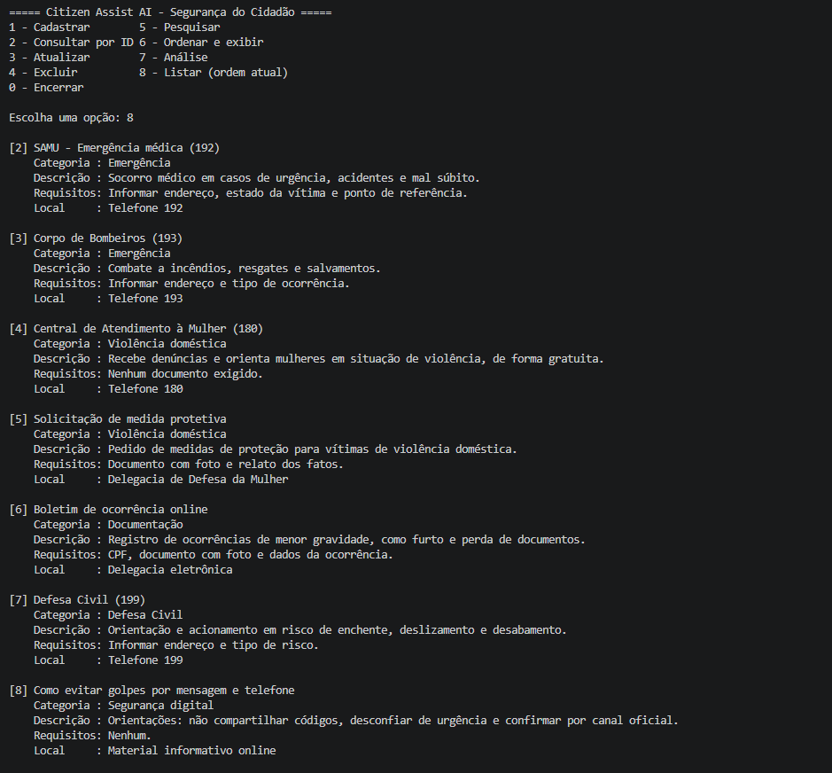

### 7. Lista vazia: ordenar
Ordenar sem registros exibe aviso, sem erro.

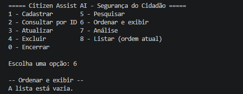

### 8. Lista vazia: análise
Análise sem registros mostra total 0.

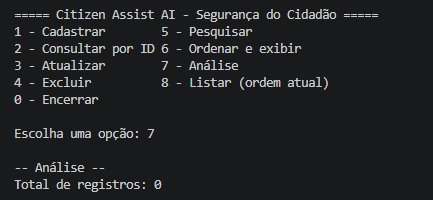

### 9. Lista vazia: consulta
Consulta sem registros exibe aviso, sem erro.

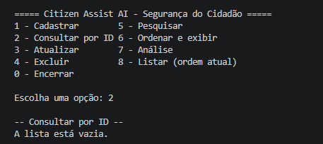

### 10. Cadastro válido e categoria inválida
Categoria acima de 40 caracteres é recusada; após corrigir, o cadastro é concluído e o registro é consultado.

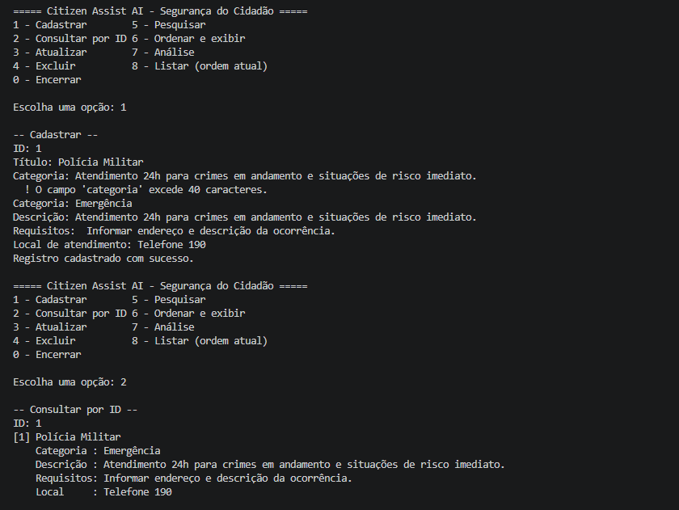

### 11. ID duplicado
Cadastro com ID já existente é recusado.

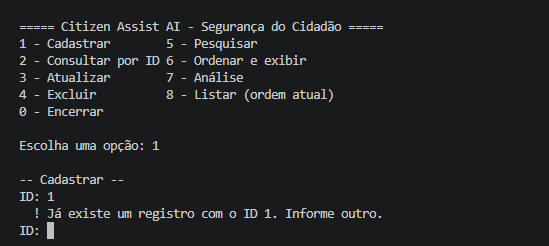

### 12. Campo obrigatório vazio
Título em branco é recusado e pedido novamente.

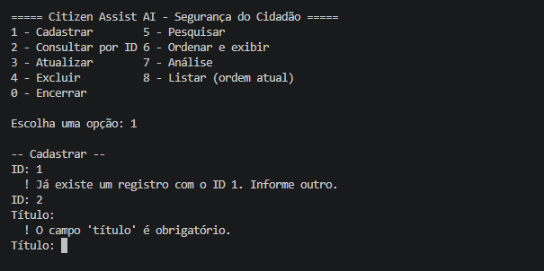

### 13. Opção inexistente
Opção `9` exibe mensagem e o menu continua.

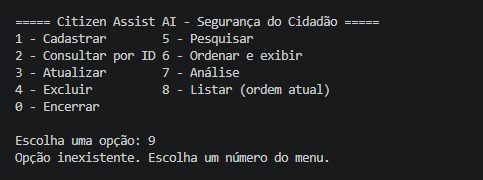

### 14. Pesquisa com resultado
Busca por título com termo `Polícia` encontra o registro.

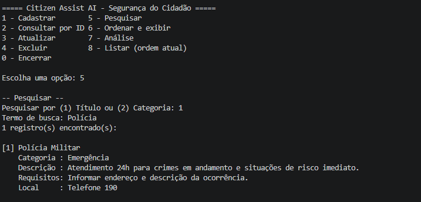

### 15. Pesquisa sem resultado
Busca sem correspondência informa que nada foi encontrado.

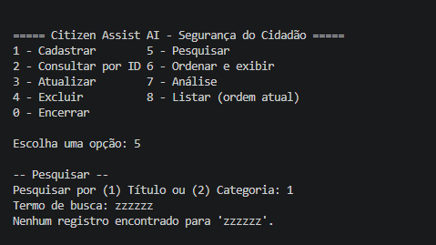

### 16. Atualização
Alteração de campos de um registro existente.

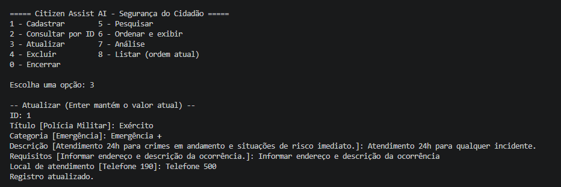

### 17. Consulta após atualização
O registro mostra os novos valores.

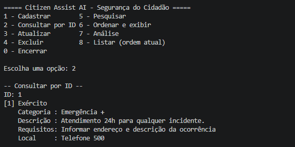

### 18. Ordenação por ID
Lista reorganizada pelo Merge Sort.

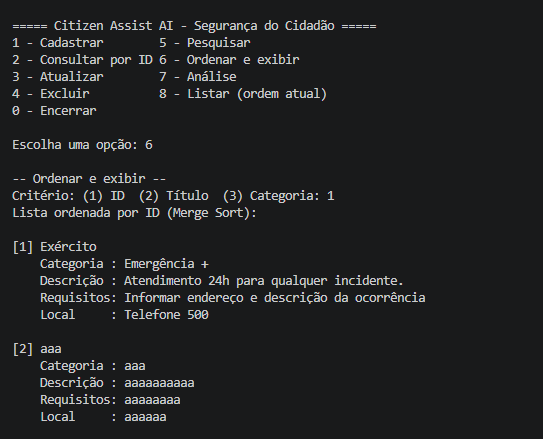

### 19. Análise por categoria
Total de registros e distribuição por categoria.

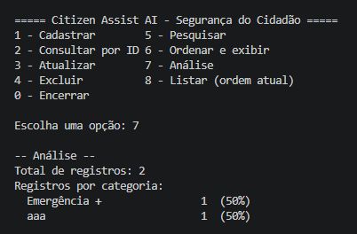

## Estrutura do projeto

```
.
├── citizen_assist.py        # Sistema completo (modelo, lista, algoritmos e menu)
├── test_citizen_assist.py   # Testes automatizados
├── DOCUMENTACAO.md          # Documentação técnica e análise Big-O
├── evidencias/              # Prints dos testes e da execução do sistema
└── README.md
```

> O arquivo `dados_servicos.json` é gerado automaticamente ao encerrar o programa. Se quiserem, adicionem-no ao `.gitignore`.
